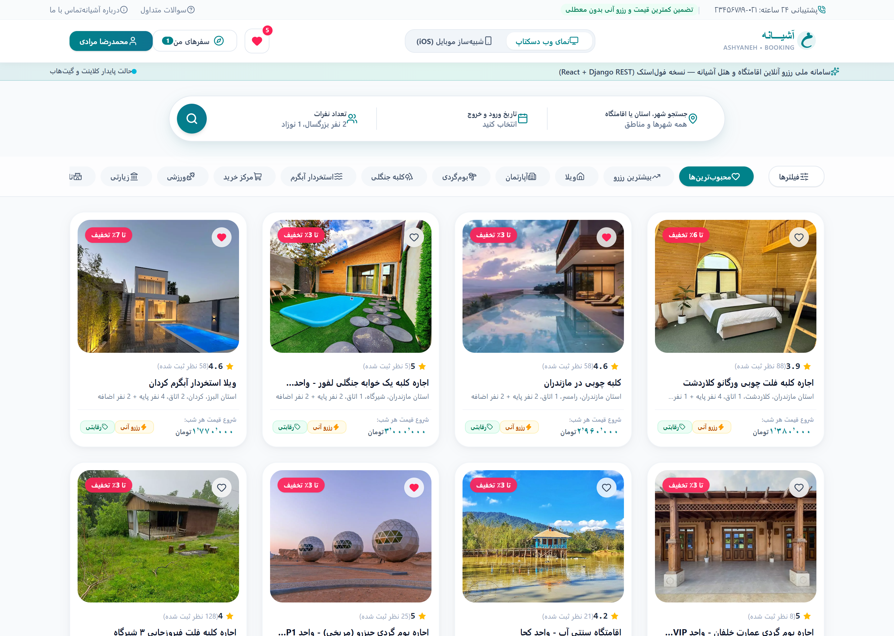
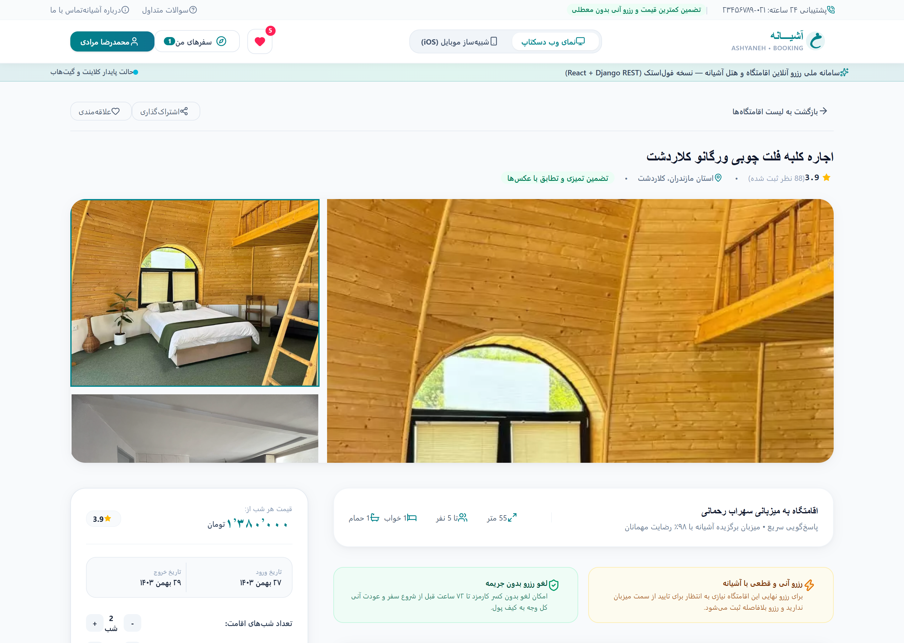
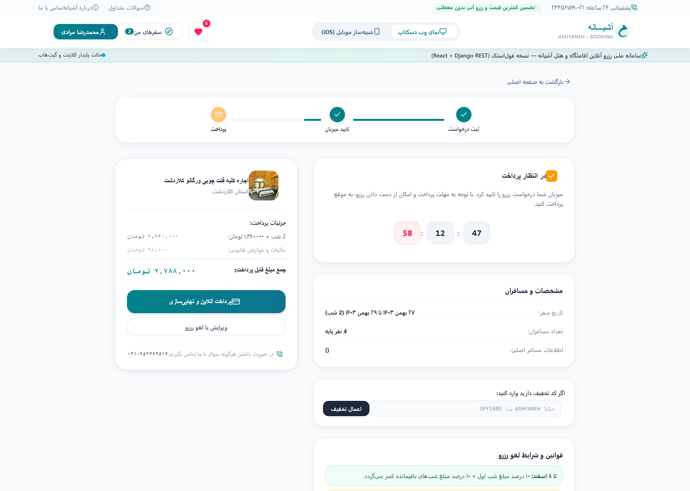
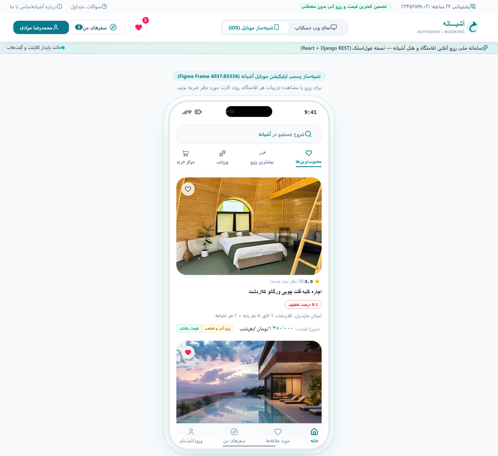
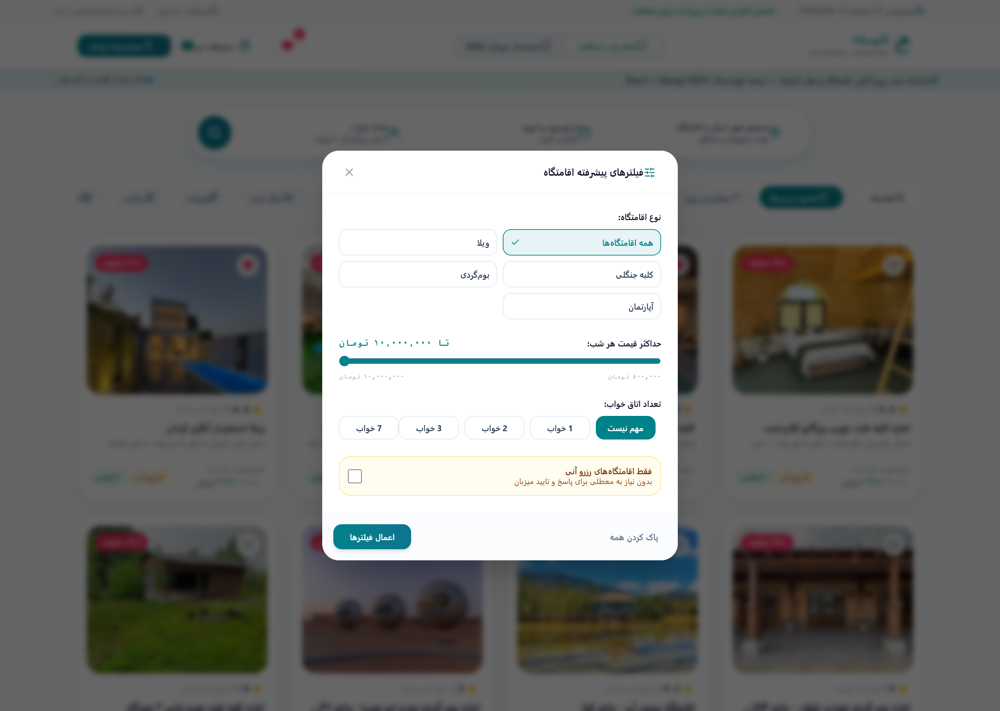

# Ashyaneh - Hotel & Apartment Online Booking Platform

A production-grade, full-stack online accommodation and hotel reservation platform engineered with React 19, Tailwind CSS v4, and Django REST Framework. Designed and developed from the ground up based on the comprehensive Iranian UI/UX kit on Figma.

[Live Demo](https://lxlnimalxl.github.io/ashyaneh-hotel-booking-platform/) | [Frontend Architecture](#frontend-architecture) | [Backend REST API](#backend-rest-api) | [Getting Started](#getting-started)

---

## Visual Showcase

### Desktop Web Experience


### Accommodation Detail (PDP) & Sticky Booking


### Multi-Step Checkout & Invoice Timer


### Native Mobile App Simulator (iOS)


### Advanced Filter Modal


---

## Architectural Highlights

### Frontend
- **React 19 & Vite 8**: Modern component architecture, reactive state management, and optimized asset pipelines.
- **Tailwind CSS v4 & Vazirmatn Typography**: Strict RTL design system matching original Persian typographic hierarchy and spacing scales.
- **Dual Display Modes**: Seamless real-time switching between a 1440px Desktop Web layout and a realistic iPhone 15 Mobile App simulator.
- **Interactive PDP**: Hero photo gallery, host credentials, spec badges, amenity tags, location map preview, and sticky reservation engine.
- **Dynamic Checkout Stepper**: Real-time 60-minute payment countdown timer, coupon redemption system (`ASHYANEH`), dynamic subtotal/tax recalculation, and payment completion celebration.
- **Interactive Modals**: Multi-criteria accommodation filtering by budget, type, bedroom count, and instant booking availability.
- **Offline / Static Demo Resilience**: Hybrid API layer connects to Django REST API in local/production server mode while gracefully falling back to deterministic local mock data on static GitHub Pages.

### Backend
- **Python 3.13 & Django 5.2**: Clean MVC/MVT architecture, declarative ORM models, and secure defaults.
- **Django REST Framework (DRF)**: Standard RESTful endpoints with serializers for accommodations, categories, bookings, and customer reviews.
- **Data Seeding Engine**: Automated database population command (`python manage.py seed`) supplying 12 authentic Iranian accommodations with pricing, ratings, and amenity matrices.
- **CORS & API Security**: Configured with `django-cors-headers` to support distributed frontend deployment.

---

## Technology Stack

| Layer | Technologies |
|---|---|
| **Frontend** | React 19, Vite 8, Tailwind CSS v4, Lucide React, Canvas Confetti |
| **Backend** | Python 3.13, Django 5.2, Django REST Framework, SQLite |
| **Typography** | Vazirmatn, Plus Jakarta Sans |
| **Design Source** | Figma UI/UX Kit (Desktop Frame 4037:83366, Mobile Frame 4037:83336) |
| **Deployment** | GitHub Pages (Frontend static client), Gunicorn / WSGI ready (Django) |

---

## Repository Structure

```text
n10/
├── backend/
│   ├── api/
│   │   ├── migrations/
│   │   ├── management/commands/seed.py
│   │   ├── models.py
│   │   ├── serializers.py
│   │   ├── urls.py
│   │   └── views.py
│   ├── core/
│   │   ├── settings.py
│   │   ├── urls.py
│   │   └── wsgi.py
│   ├── manage.py
│   └── requirements.txt
├── screenshots/
│   ├── 01-desktop-home.png
│   ├── 02-property-detail.png
│   ├── 03-reserve-invoice.png
│   ├── 04-mobile-app-simulator.png
│   └── 05-advanced-filters.png
├── src/
│   ├── assets/images/
│   ├── components/
│   │   ├── booking/
│   │   ├── detail/
│   │   ├── home/
│   │   ├── layout/
│   │   ├── mobile/
│   │   └── modals/
│   ├── data/
│   ├── services/
│   ├── App.jsx
│   ├── index.css
│   └── main.jsx
├── index.html
├── package.json
└── vite.config.js
```

---

## Getting Started

### 1. Frontend Setup

```bash
# Clone the repository
git clone https://github.com/lxlnimalxl/ashyaneh-hotel-booking-platform.git
cd ashyaneh-hotel-booking-platform

# Install dependencies
npm install

# Start development server
npm run dev

# Build production bundle
npm run build
```

### 2. Backend Setup (Django REST API)

```bash
cd backend

# Create and activate virtual environment (optional)
python -m venv venv
source venv/bin/activate  # On Windows: venv\Scripts\activate

# Install requirements
pip install -r requirements.txt

# Run migrations and seed authentic demo accommodations
python manage.py migrate
python manage.py seed

# Start API server on port 8000
python manage.py runserver 8000
```

The REST API endpoints will be accessible at:
- `GET /api/accommodations/` - List all accommodations (with `category`, `search`, `min_price`, `max_price`, `rooms`, `instant` filters)
- `GET /api/accommodations/{id}/` - Accommodation details with reviews
- `POST /api/accommodations/{id}/favorite/` - Toggle favorite status
- `POST /api/bookings/` - Create a reservation
- `POST /api/bookings/{id}/confirm_payment/` - Confirm booking payment

---

## License & Credits

- Designed from Figma Community Kit: *اپلیکیشن و وب‌سایت رزرو آنلاین هتل و آپارتمان (Hotel & Apartment Booking App)*.
- Developed by **Seyyed Nima Rounaghi** ([@lxlnimalxl](https://github.com/lxlnimalxl)).
